<p align="center">
  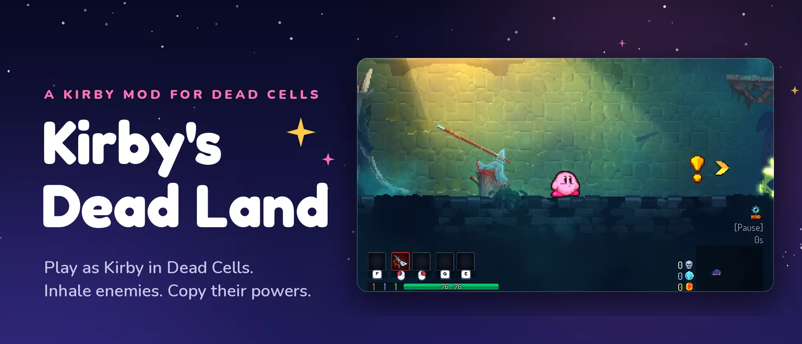
</p>

<p align="center">
  <a href="https://github.com/NahuelGenchi/kirbys-dead-land/releases/latest"></a>
  &nbsp;
  <a href="https://github.com/NahuelGenchi/kirbys-dead-land/releases">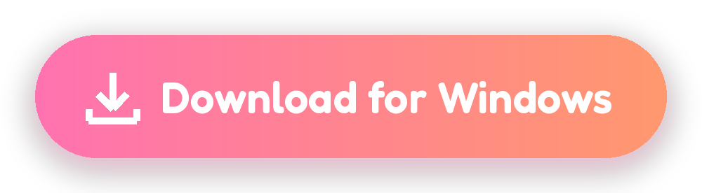</a>
</p>

<p align="center">
  Free · Bring your own copy of Kirby Super Star Ultra · Windows is still a test version
</p>

<p align="center">
  <a href="#how-kirby-plays"><b>How Kirby plays</b></a> &nbsp;·&nbsp;
  <a href="#install"><b>Install</b></a> &nbsp;·&nbsp;
  <a href="#controls"><b>Controls</b></a> &nbsp;·&nbsp;
  <a href="#whats-different-from-normal-dead-cells"><b>What's different</b></a> &nbsp;·&nbsp;
  <a href="#questions"><b>Questions</b></a>
</p>

<br>

Kirby's Dead Land lets you **play as Kirby inside Dead Cells**. Kirby runs, floats,
inhales enemies and copies their powers, just like on the Nintendo DS, because the
real Kirby Super Star Ultra is running inside the mod and moving him. Dead Cells
brings everything else: its levels, enemies, shields, shops and your progress from
run to run.

<table>
  <tr>
    <td width="33%" valign="top">
      <h3>⭐ The real Kirby</h3>
      His moves, his 24 copy abilities, his sprites and his sounds all come from your own copy of the DS game.
    </td>
    <td width="33%" valign="top">
      <h3>🏰 The real Dead Cells</h3>
      The same levels, enemies, bosses, shops and unlocks. A few rules change so they fit Kirby.
    </td>
    <td width="33%" valign="top">
      <h3>🛡️ Your games stay safe</h3>
      Nothing in your Steam folder changes. Kirby has his own saves, and your normal saves are backed up every time you play.
    </td>
  </tr>
</table>

## How Kirby plays

<table>
  <tr>
    <td width="50%" valign="top">
      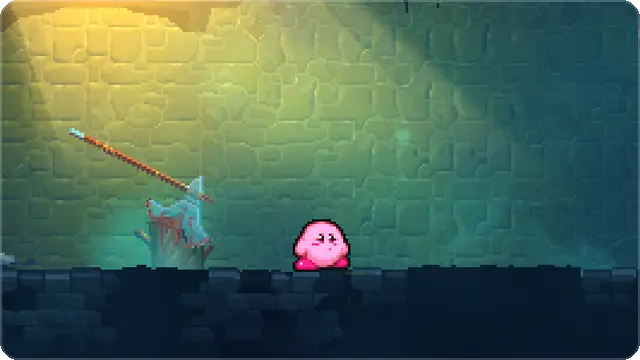
      <h3>Inhale, swallow, copy</h3>
      Hold the attack button to suck an enemy in, then press Down to swallow it. Kirby copies a random power. There are 24 to find.
    </td>
    <td width="50%" valign="top">
      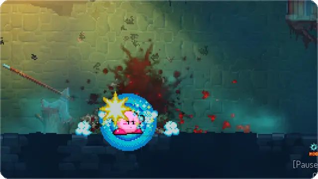
      <h3>Keep your shield</h3>
      Kirby carries one Dead Cells shield, even while he has a power. Block at the right moment and it's a parry.
    </td>
  </tr>
  <tr>
    <td width="50%" valign="top">
      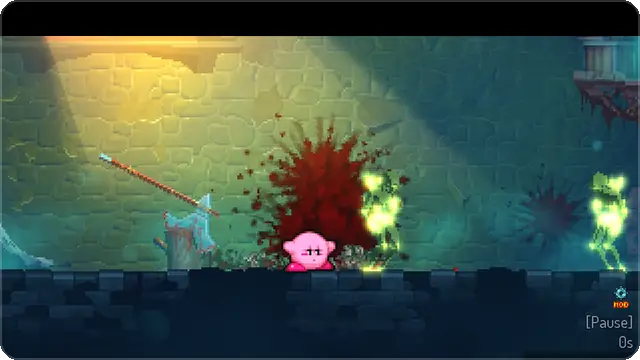
      <h3>Spit stars</h3>
      Don't want the power? Spit the enemy back out as a star. It flies across the room, hits hard and stuns.
    </td>
    <td width="50%" valign="top">
      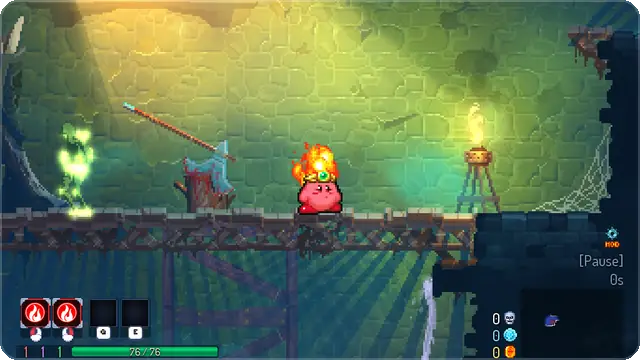
      <h3>Lose it, catch it</h3>
      Take a hit, or drop your power on purpose, and it pops out as a bouncing star that hurts enemies. Swallow it within 7 seconds to get it back.
    </td>
  </tr>
  <tr>
    <td width="50%" valign="top">
      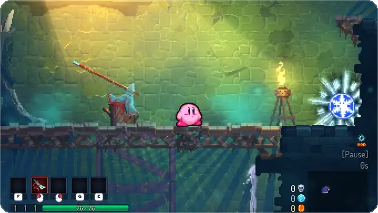
      <h3>Weapons turn into powers</h3>
      Kirby can't hold a sword or a bow. Every weapon and skill you find becomes an <b>ability item</b> instead: inhale it and swallow it to copy that power.
    </td>
    <td width="50%" valign="top">
      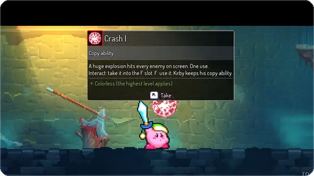
      <h3>Save a big one for later</h3>
      Crash, Paint, Mike and Cook are kept in a separate slot. Grab one with <kbd>R</kbd>, then press <kbd>F</kbd> whenever you need it. Kirby keeps his other power.
    </td>
  </tr>
  <tr>
    <td width="50%" valign="top">
      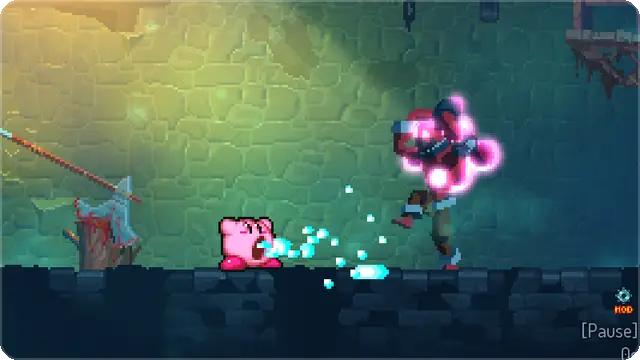
      <h3>Eat what they throw</h3>
      Arrows and grenades thrown at Kirby can be inhaled too. Spit them back as a star at whoever threw them.
    </td>
    <td width="50%" valign="top">
      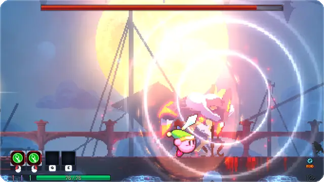
      <h3>Bosses fight back</h3>
      Bosses are too big to swallow, just like in the DS game. Fight them with the power you bring.
    </td>
  </tr>
</table>

### A few of the 24 copy abilities

<table>
  <tr>
    <td width="33%" align="center">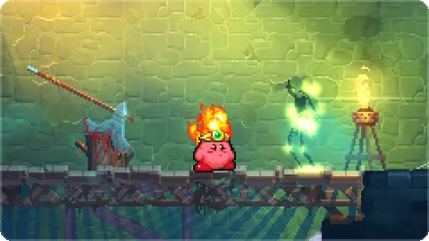<br><b>Fire</b></td>
    <td width="33%" align="center">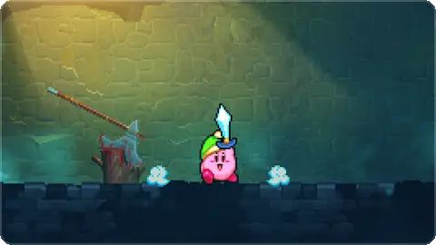<br><b>Sword</b></td>
    <td width="33%" align="center">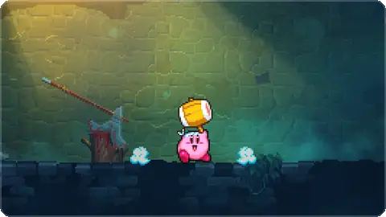<br><b>Hammer</b></td>
  </tr>
  <tr>
    <td width="33%" align="center">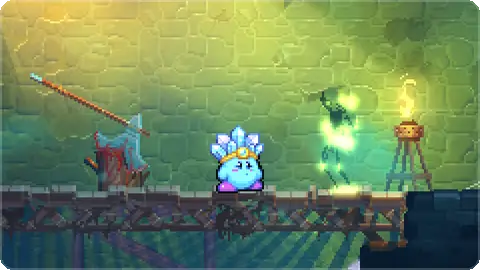<br><b>Ice</b></td>
    <td width="33%" align="center">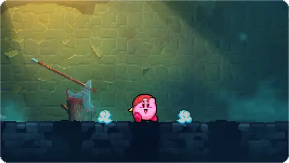<br><b>Wheel</b></td>
    <td width="33%" align="center">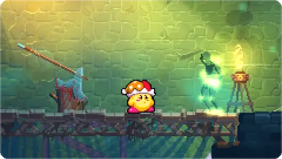<br><b>Beam</b></td>
  </tr>
  <tr>
    <td width="33%" align="center">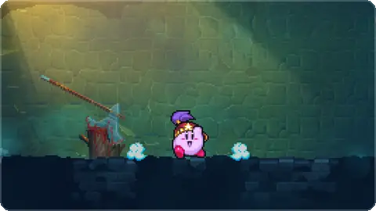<br><b>Ninja</b></td>
    <td width="33%" align="center">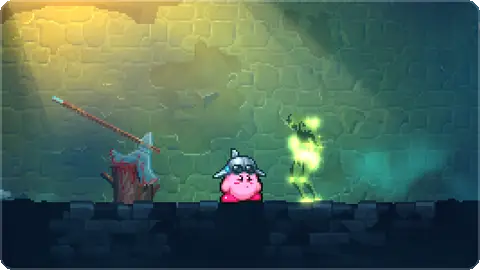<br><b>Jet</b></td>
    <td width="33%" align="center">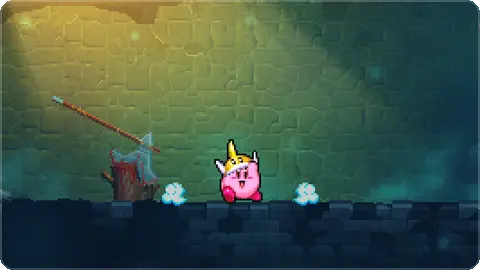<br><b>Cutter</b></td>
  </tr>
</table>

<p align="center">
  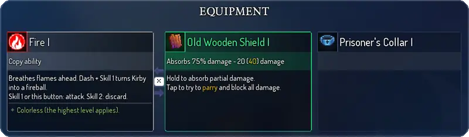
</p>

Not sure what your power does? Press <kbd>Esc</kbd>: the pause screen explains it
and lists its main moves with your own controls.

### Moving like Kirby, at Dead Cells speed

Kirby keeps all his DS moves and animations, but runs as fast as the Beheaded so
the levels still feel right. He floats over gaps, climbs ladders, chains and vines,
and **slides** where the Beheaded would roll, so he fits through roll tunnels and
bursts doors open. In the air, the dive button makes him **stomp**: it hits and
stuns enemies and, once you have the Ram rune, breaks weak floors. Touching an
enemy doesn't hurt, just like in Dead Cells: only their attacks do.

You also get Kirby's **helper**: the Homunculus button turns a power into a
computer-controlled friend who fights beside you.

## Install

### What you need

- 💻 A 64-bit PC with **Linux** (Windows works as a test version, see below)
- 🎮 **Steam** with **Dead Cells** installed (tested with version 35)
- ⭐ **Your own copy of Kirby Super Star Ultra (USA)** as a `.nds` file. It is not
  included here. The mod only reads it and never changes it.
- 💾 About **1 GB** of free disk space, and about **6 GB** of free memory while playing

### Four steps

<table>
  <tr>
    <td width="50%" valign="top">
      <b>1 · Download and open the launcher</b><br>
      On Linux, download the <code>.AppImage</code> from the
      <a href="https://github.com/NahuelGenchi/kirbys-dead-land/releases/latest">latest release</a>.
      Right-click it, open <b>Properties</b> and turn on <b>Allow running as a program</b>. Then double-click it.
    </td>
    <td width="50%" valign="top">
      <b>2 · Let it check your PC</b><br>
      It looks for Steam, Dead Cells and your Kirby game by itself. If something is missing, it tells you what to do.
      <br><br>
      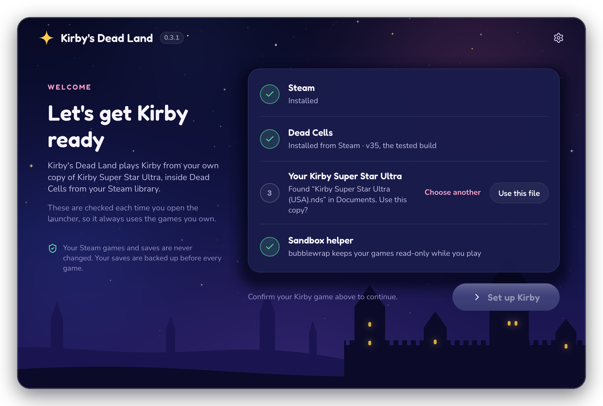
    </td>
  </tr>
  <tr>
    <td width="50%" valign="top">
      <b>3 · Set up Kirby, once</b><br>
      Press <b>Set up Kirby</b>. It builds your Kirby from your own game files in about two minutes.
      <br><br>
      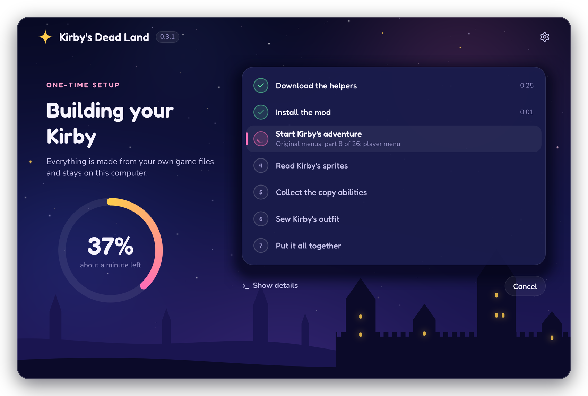
    </td>
    <td width="50%" valign="top">
      <b>4 · Press Play 🎉</b><br>
      From now on, open the launcher and press <b>Play</b>. Choose <b>New Game</b> to start a Kirby run.
      <br><br>
      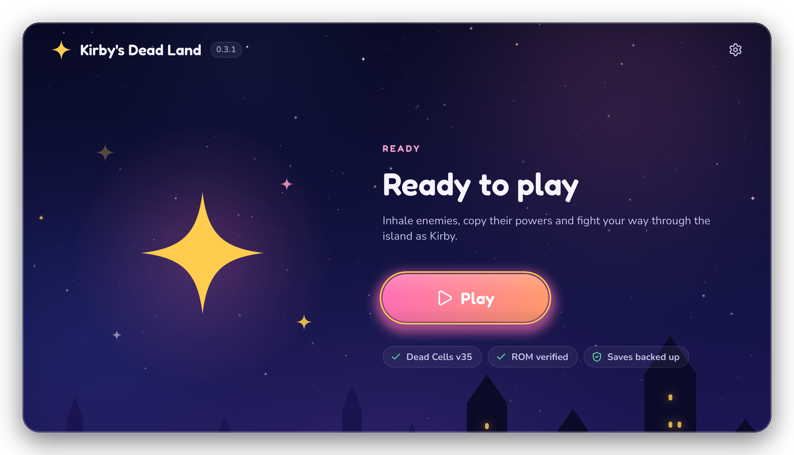
    </td>
  </tr>
</table>

<sub>The launcher pictures use stand-in art. On your PC, the launcher shows your Kirby, made from your own game.
The <a href="docs/LAUNCHER.md">launcher guide</a> explains every step.</sub>

**On Windows:** the [newest test release](https://github.com/NahuelGenchi/kirbys-dead-land/releases)
has a `.zip` for Windows. Right-click it, choose **Extract All**, open the folder and
double-click **Kirby's Dead Land**. If Windows says it protected your PC, choose
**More info**, then **Run anyway**. The game has been played on a Windows 11 PC from
a test build, but this download has not been tried on a real Windows 11 PC yet.

## Controls

These are Dead Cells' default keys. Kirby follows your own bindings, so if you change
a key in the game's controls menu, Kirby follows it.

| To… | Press |
| :--- | :--- |
| Jump, or float (press again in the air) | <kbd>Space</kbd> |
| Inhale, spit, or attack with your power | <kbd>Left-click</kbd> or <kbd>E</kbd> |
| Swallow what's in your mouth | <kbd>Down</kbd> |
| Slide (fits through roll tunnels, bursts doors) | <kbd>Shift</kbd>, or <kbd>Down</kbd> + <kbd>Space</kbd> |
| Stomp, in the air | <kbd>Down</kbd> + <kbd>Space</kbd> |
| Block and parry with your shield | <kbd>Right-click</kbd> |
| Guard | <kbd>Ctrl</kbd> |
| Drop your power | <kbd>Q</kbd> |
| Pick things up, or take Crash, Paint, Mike or Cook | <kbd>R</kbd> |
| Use the saved Crash, Paint, Mike or Cook | <kbd>F</kbd> |
| Make or call back the helper | your Homunculus key |
| Read what your power does | <kbd>Esc</kbd> |

**With a controller**, it works the same, with four changes: <kbd>B</kbd> slides,
<kbd>LT</kbd> guards, holding <kbd>RT</kbd> for a moment drops your power (so a brushed
trigger doesn't), and the stick needs a clear up or down push, so a sideways push
that drifts a little still just runs.

## What's different from normal Dead Cells

Kirby can't hold a sword, so a few rules change to fit him. Everything else is the
Dead Cells you know.

| | In Dead Cells | With Kirby |
| :--- | :--- | :--- |
| **Weapons and skills** | You pick them up and use them | They become **ability items**: inhale and swallow one to copy its power. Their bonus effects still work. |
| **Your starting sword** | A Rusty Sword | It stays in its slot, but its button inhales instead of swinging |
| **Shields** | Block and parry | The same. Kirby holds one, even with a power, and swaps it for a new one |
| **Elite enemies** | A tough fight | Swallowing one always gives a **Legendary Sword** that hits much harder, until you lose it |
| **Healing** | The health flask | No flask. Eat food, and use health fountains (they heal half your maximum health). Cook makes enemies drop food |
| **Scrolls** | Make your weapons stronger | Make your **copy attacks** stronger. With the right mutations, copy attacks land critical hits too |
| **Mutations** | All of them | The ones that need weapons, ammo or skills are left out. The rest work on copy attacks |
| **The forge** | Upgrades weapons | Rerolls and upgrades your power's ability item |
| **The Collector** | Every upgrade | Hides upgrades that do nothing for Kirby |
| **Achievements** | On | Off while the mod runs |

<details>
<summary><b>Every rule, in detail</b></summary>
<br>

- Absorbing a Dead Cells enemy selects a random original copy ability.
  While copied, the pause screen (Escape) describes the ability and its main
  moves in the mod's controls; see
  [ability descriptions](docs/GAMEPLAY_FIDELITY.md#ability-descriptions).
- Absorbing an Elite always gives original Sword as a Legendary ability item,
  which deals more damage (×2.25 at item level I)
  until the ability is lost (hit off, discarded, made into a helper, or a new run).
  This is a deliberate deviation; see `docs/GAMEPLAY_FIDELITY.md`.
- Kirby fights only with original inhale and copy abilities plus a Dead Cells
  shield (#39). Every non-shield weapon button (left-click by default) is the
  original B button: inhale/spit in base form, the copy attack while copied.
  Host swords and bows never attack, including the starting sword.
- Copied Kirby retains the exact shield it carried for parrying. Taking a
  dropped shield swaps it in as in Dead Cells, in either form, and the new
  shield becomes the one that parries. Kirby holds one shield: taking or
  buying another drops the one he had (#139).
- Items Kirby cannot use (every weapon other than a shield, and skills) get
  Dead Cells' own "Can't use that right now" message and stay on the ground; a
  long press still recycles them.
- In a Kirby run, every new floor weapon other than a shield, and every skill,
  on the floor, on challenge-room and legendary altars and timed pedestals, or in
  a shop, becomes a colorless **ability item**: one of the 24 copy abilities,
  shown with its original icon. Walking near one shows its name, description and colorless
  rarity. It cannot be picked up: inhale it and swallow it to copy that ability;
  spitting it out puts it back. While copied, the ability's item fills a weapon
  slot and the HUD. Its passives (affixes such as bleed or the arrow shot) act on
  copy attacks like a weapon's (#57). Losing the copy (a hit or a discard) puts
  the item on the dropped ability star, which lasts 7 seconds: swallowing the
  star again gives back that same item, with its level, quality and affixes;
  when the star runs out, the item is gone (#68). The forge rerolls and
  upgrades the copy's item as it does a weapon, and never lists the starting
  Rusty Sword (#58). See
  [ability items](docs/GAMEPLAY_FIDELITY.md#ability-items-intentional-addition).
- Mutations that need Dead Cells weapons, ammo or skill use (Barbed Tips, Ripper,
  the backpack mutations, Kill Rhythm, Ranger's Gear, Scheme, Ammo, Support,
  Parting Gift and Networking) are not
  offered in a Kirby run (#90). See
  [mutation menu](docs/GAMEPLAY_FIDELITY.md#mutation-menu-intentional-deviation).
- The Collector does not list upgrades that do nothing for Kirby (#99): weapon
  and skill blueprints, Random Starter Bow, Random Melee Weapon, the backpack and
  the mutations above. A hidden blueprint you have found counts as unlocked for
  the "unlock N more items" gates. See
  [Collector](docs/GAMEPLAY_FIDELITY.md#collector-intentional-deviation).
- Kirby has no health flask (#101): F does not heal. He heals by eating Dead
  Cells food and at health fountains, which heal half his maximum health. Health
  Flask I–IV and the flask mutations (Extended Healing, Emergency Triage, Tainted
  Flask, Cursed Flask) are hidden; the Collector's gates no longer need Health
  Flask I. See
  [health flask and fountains](docs/GAMEPLAY_FIDELITY.md#health-flask-and-fountains-intentional-deviation).
- Crash, Paint, Mike and Cook are limited-use abilities (#102). They are never
  swallowed: no enemy gives them, the Mix roulette of a mouthful of several
  enemies no longer stops on them (#141), and their floor item is taken with
  Interact (R by default) into the F slot, replacing (and dropping) any stored
  one. F fires the original attack while Kirby keeps his copy ability; Mike has
  three shouts, the others one use. See
  [F slot](docs/GAMEPLAY_FIDELITY.md#f-slot-limited-use-abilities-intentional-deviation).
- Original inhale, mouthful, Down-to-swallow, spit, flight, guard, slide and copy
  discard are executed by the ROM. All 24 original copy forms load through the
  original transformation code, rather than replacing them with host weapons.
- Hostile Dead Cells projectiles (arrows, grenades) can be inhaled. The ROM
  holds them as an ordinary copyless mouthful: spit fires the original star at
  enemies, and swallowing gives nothing. Kirby's own arrows are never inhaled.
- Spat stars and discarded ability stars are projectiles in Dead Cells. The ROM
  still moves them through the level: spit stars burst on walls, the discarded
  star bounces. A star staggers each enemy it hits with the host dive's stun and
  knockback. A discarded star, harmless in the ROM, hits for the single
  spit star's original 52 damage, and lasts 7 seconds instead of the ROM's 8
  (#68). A star still out when Kirby takes a level exit starts again at his
  position in the next level, so it cannot be left inside a wall there (#172).
  These are deliberate deviations; see
  [star projectiles](docs/GAMEPLAY_FIDELITY.md#star-projectiles).
- Each ordinary enemy consumed by the original Cook also drops one Dead Cells
  healing food item through the game's own loot drop. Cook's original damage is
  unchanged; Bosses and Elites drop no food.
- Copy attacks count as colorless gear: their damage is multiplied by
  1.15^(tier − 1), where tier is 1 + your highest scroll count (Brutality,
  Tactics or Survival). With no scrolls this factor is ×1. See
  [colorless copy damage](docs/GAMEPLAY_FIDELITY.md#colorless-copy-damage).
- Copy attacks can crit (×1.5, drawn as a Dead Cells crit). Kirby has no crit
  chance of his own: mutations will add it (#89). See
  [copy-attack critical hits](docs/GAMEPLAY_FIDELITY.md#copy-attack-critical-hits-intentional-addition).
- The five skill-cooldown mutations (Killer Instinct, Blind Faith, Heart of Ice,
  Hunter's Instinct, Instinct of the Master of Arms) give timed crit chance or damage
  in a Kirby run, with new text in the mutation menu (#89). See
  [cooldown mutations](docs/GAMEPLAY_FIDELITY.md#cooldown-mutations-intentional-deviation).
- Every copy attack counts as a melee attack for mutations: the damage mutations
  (Tranquility, Combo, Vengeance, Point Blank and others) now change copy-attack
  damage, and mutation text says "copy attack" (#91). See
  [mutations on copy attacks](docs/GAMEPLAY_FIDELITY.md#mutations-on-copy-attacks).
- While copied, each non-shield weapon slot in the HUD (normally Left-Click)
  shows the current ability's original icon in a colorless slot. See the
  [HUD ability slot](docs/GAMEPLAY_FIDELITY.md#hud-ability-slot). The pause
  screen's equipment card for that slot shows the ability too.
- As in Dead Cells, touching an enemy does not hurt Kirby: only enemy attacks do
  (and the few Dead Cells enemies whose bodies are spiked or electric). Bumping
  into enemies does not hurt them either; inhaling, sliding and copy attacks do.
  A Thorny's spikes answer Kirby's own hits on its back, not the CPU helper's
  (#206, [source test and a lab probe with a marked hit](docs/GAMEPLAY_FIDELITY.md#the-helper-and-the-thornys-spikes-206-intentional-deviation); not seen with a real helper).
- Kirby moves at the Beheaded's speeds, measured in the game: he runs and steers
  in the air at 236.5 px/s, slides as far and as fast as the Beheaded rolls,
  falls at 403 px/s, stomps at the dive's 900 px/s and floats across at running
  speed. His climb speeds up as his run does, to 265 px/s up and 315 px/s down,
  faster than the Beheaded's 97.5 px/s. He climbs ladders, chains and vines grown with
  the Vine rune, and climbs from a vine onto the ledge it leads to. He stops when the
  direction is released and turns at once, and his jump keeps its height but peaks as
  fast as the Beheaded's. Dash attacks, Wheel's roll and other copy-ability moves faster
  than his dash keep their original lead over the run. His animations are the
  original ones; the walk and dash cycles play faster with the run so his feet
  keep up.
- The helper (Homunculus binding) reacts within 6 frames and moves at Kirby's
  speed (#105); see
  [Helper](docs/GAMEPLAY_FIDELITY.md#helper-reacts-at-once-and-keeps-pace-with-kirby-105-intentional-deviation).
- Host tutorials for replaced jump, dodge and Homunculus actions, and the flask's
  "heal" tutorial, are suppressed while playing Kirby; equipment and interaction
  tutorials remain available.

</details>

<details>
<summary><b>Every binding, in detail</b></summary>
<br>

Existing Dead Cells bindings are used:

| Dead Cells action | Kirby action |
|---|---|
| Move / directional input | Original movement and move combinations |
| Jump | Jump / puff / flight |
| Down + jump on the ground | Original slide; passes roll-zone tunnels and bursts doors like a roll |
| A Shift key bound to Dodge (Shift by default), on the ground | The same original slide, once per press |
| Dive attack binding in the air or on a chain (Down + jump by default) | Stomp through the host dive attack; a floating Kirby exhales first, a climbing Kirby kicks off the chain |
| Dodge, any other key (Ctrl by default) | Original Kirby guard |
| Skill 1 | Inhale / spit / copy ability attack |
| Down with a mouthful | Swallow and transform |
| Skill 2 | Discard the current copy ability |
| Homunculus | Create / return the original helper; it reacts within 6 frames and moves at Kirby's speed (#105) |
| Weapon buttons other than a shield (left-click by default), base form | Inhale / spit (original B) |
| Weapon buttons other than a shield, copied form | Copy attack (original B) |
| Shield button | Host shield parry and original guard; while copied, only the retained shield |
| Interact (R by default) on a Crash, Paint, Mike or Cook item | Take it into the F slot |
| Heal (F by default) | Fire the stored limited-use ability; Kirby keeps his copy ability |

A controller uses the same actions with four differences (`ControllerLayout`,
no controller run recorded; Xbox names for Dead Cells' default layout; see the
[controller layout](docs/GAMEPLAY_FIDELITY.md#controller-layout-130-intentional-deviation)):

| Controller | Kirby action |
|---|---|
| Left stick | 8-way: Up and Down need a clearly vertical tilt, so a sideways stick that drifts down still runs |
| Dodge (B), on the ground | Original slide, once per press |
| Skill 1 (LT) | Original Kirby guard |
| Skill 2 (RT), held 0.3 s | Discard the current copy ability; a tap does nothing |

Shared bindings remain shared: if W is assigned to both Up and Jump, it sends
both actions. Change either binding in the game's controls menu to separate them.
In the recorded profile's default keyboard layout, **left-click** and **E**
inhale/spit/attack with a copy ability, **Q** discards it, **Space** jumps, and
**right-click** uses the shield (or, if the second slot holds another weapon,
also inhales). Keyboard X is a contextual menu binding; controller X is the
primary weapon button. The adapter follows the configured actions, so
remapping them in the game's controls menu also changes Kirby's controls.

</details>

<details>
<summary><b>Settings for tinkerers</b></summary>
<br>

The mod reads these from `config.json` in its mod folder
(`lab/coremod/mods/KirbySuperStarUltra/` inside the launcher's data folder, which
**Settings › Launcher files** opens). Setting up or updating the mod copies the
defaults back.

| Setting | Default | What it does |
| :--- | :--- | :--- |
| `CameraZoom` | `1` | `1` keeps the Beheaded's camera; `2` zooms in to about the DS screen's height (the clips on this page use `2`) |
| `AlwaysDash` | `true` | A held direction dashes; a light analog tilt still walks |
| `ControllerLayout` | `true` | The [controller layout](docs/GAMEPLAY_FIDELITY.md#controller-layout-130-intentional-deviation) above; `false` reads a controller like the keyboard |
| `MatchHostSpeed` | `true` | The Beheaded's speeds; `false` keeps the DS speeds (the stomp always moves at the dive's speed) |
| `OriginalTouchDamage` | `false` | `true` brings back the DS game's touch damage, which hurts Kirby and weak enemies on contact |
| `CopyDamageScale` | `2.625` | How hard copy attacks hit: a Zombie takes three Sword hits ([damage balance](docs/GAMEPLAY_FIDELITY.md#damage-balance-128-intentional-deviation)) |
| `HelperCopyDamageScale` | `1.75` | The helper's own scale: four Sword hits |
| `FlashStrength` | `0.35` | How strong the hurt and guard flash is; `1` is the DS game's full white flash |
| `DoubleArm9Clock` | `true` | Runs the DS processor at twice its speed so it lags less among many enemies ([details](docs/GAMEPLAY_FIDELITY.md#the-originals-processor-at-twice-the-ds-clock-150-intentional-deviation)) |
| `Recompiler` | `true` | Runs the DS game on the emulator's faster recompiler; `false` uses the interpreter ([details](docs/GAMEPLAY_FIDELITY.md#the-original-on-the-recompiler-153-intentional-deviation)) |

</details>

## How it works

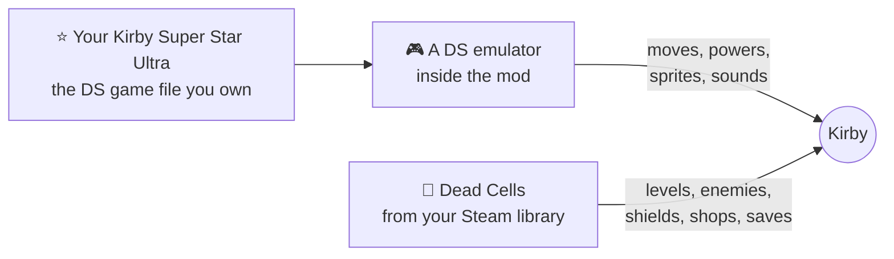

The mod runs your own copy of Kirby Super Star Ultra in a built-in DS emulator
([melonDS](https://melonds.kuribo64.net/)) and feeds it your Dead Cells controls.
The DS game decides how Kirby moves, what his powers do, how he looks and how he
sounds, and the mod draws him into Dead Cells and turns his hits into Dead Cells
damage. Enemies, levels and items stay Dead Cells' own. Neither game is changed on
disk: the mod is loaded by [Dead Cells Core Modding](https://github.com/dead-cells-core-modding/core),
the Dead Cells music keeps playing and Kirby's sound effects play on top.

## Questions

<details>
<summary><b>Where do I get Kirby Super Star Ultra?</b></summary>
<br>
You need your own copy of the US version (revision 0) as a <code>.nds</code> file.
This project doesn't include it and can't give it to you. The launcher checks that
the file is the right version before it uses it.
</details>

<details>
<summary><b>Will it touch my normal Dead Cells saves?</b></summary>
<br>
No. Kirby runs use their own saves, your normal saves are backed up every time you
press Play, and the launcher checks afterwards that they didn't change. Nothing is
installed into the Steam game folder.
</details>

<details>
<summary><b>Does it work on the Steam Deck, Mac or other PCs?</b></summary>
<br>
It's made for 64-bit Linux PCs, and a Windows version is being tested. The Steam
Deck and other systems haven't been tried. If you try it,
<a href="https://github.com/NahuelGenchi/kirbys-dead-land/issues/new">tell us how it went</a>!
</details>

<details>
<summary><b>Something went wrong. What do I do?</b></summary>
<br>
<a href="https://github.com/NahuelGenchi/kirbys-dead-land/issues/new">Open an issue</a>
and tell us what happened. In the launcher, <b>Settings › Last game log</b> shows the
log you can attach.
</details>

<details>
<summary><b>Is every part of Dead Cells covered?</b></summary>
<br>
Not yet. The main things (inhaling and copying, shields, stars, items, food, saves,
bosses) were checked in the real game, and the list is below. Not every enemy,
trap, item and boss phase has been tried with Kirby.
</details>

## Verified behavior

These were checked in the real game, in isolated test runs. Each line links to its
record.

<details>
<summary><b>See everything that was checked</b></summary>
<br>

- The new outfit walks and jumps in a real isolated Prisoners' Quarters run at
  the original approximately 59.8261 frames per second. Host/source positions
  remain stable, including landing on an upper platform.
- Normal host key bindings and inverted movement pass the live input check. In
  base form, holding left-click on the starting sword sent original B and ran the
  original inhale, with no host sword attack (run `20261006-122227`, #39). Its
  movement phase uses the production input reader.
- Native movement rebasing preserves original position, velocity and animation
  traces. Original one-way platforms, slopes and swimming have source tests.
- The runtime sprite compositor matched 3,068,161 original framebuffer pixels
  over 29 cases: idle, all 24 abilities and four left-facing attack sequences.
  These comparisons do not prove every move or every background/window effect.
- Actual host Zombies are consumed through original suction and mouthful capture,
  followed by random source transformations. Retained physical shields perform
  real parries/counters while Kirby is evolved. Multi-enemy contents use original Mix.
- Source Sword collisions preserve 18/16 damage events and repeat-hit timing.
  Live Wheel attacks delivered exact 23/14/23 damage, and incoming host damage
  kept source and host health equal. Original guard/invulnerability have source tests.
- Fresh game processes resumed the exact saved source frame, position, copy and
  physical shield. A source save during suction reproduced the next 30 frames exactly.
- Standing 12×12 and crouching 12×6 source hurtboxes passed actual host collision
  queries: interior attacks hit and attacks just outside miss. Every temporary
  projection restored the host physical body afterward.
- A generated Dead Cells door breaks from Suplex's dash grab lunge, through the
  host's roll check (run `20261006-211833`; the control without it left the door shut).
- A generated Dead Cells door breaks from original Sword damage. Actual biome
  transitions preserve copy and shield, and changing outfits preserves health.
  Lethal source damage ends the host run; New Game resets Kirby's full original state.
- Original Crash, Paint and Mike effects were verified in the running host game,
  with the HUD outside the background tint.
- Crash, Paint and Mike struck every Zombie in the Dead Cells view, including
  ones the original could not reach, and left one off screen untouched (runs
  `20261007-005031`, `004842`, `004639`; see
  [Screen-wide attacks](docs/GAMEPLAY_FIDELITY.md#screen-wide-attacks-69)).
- Original ladder, Suplex, Cook, helper and Wheel helper riding have source tests.
- The helper's quick reaction and Kirby's speed have source tests only; no live game check
  yet (see [Helper](docs/GAMEPLAY_FIDELITY.md#helper-reacts-at-once-and-keeps-pace-with-kirby-105-intentional-deviation)).
- Kirby rides a real host `SimpleElevator` up and down in isolated live runs,
  standing on its surface at full speed both ways, and can jump on a rising one
  and land on it again.
  Original objects ride with him while it moves (an intentional deviation; see
  [Host elevators](docs/GAMEPLAY_FIDELITY.md#host-elevators-deviation)). Other
  elevator types and generated elevator levels were not run live.
- On a display the frame pacer does not lock to (75 Hz on the owner's Windows
  PC), Kirby is drawn between his last two original positions, so he and his
  helper move evenly and stay on a moving elevator (an intentional deviation; see
  [Between original frames](docs/GAMEPLAY_FIDELITY.md#between-original-frames-265-intentional-deviation)).
  At 60 Hz nothing changes; that was not run again live.
- In live runs `20261005-232657` and `20261005-232901`, Kirby climbed natural
  vines grown through the host's own `VineLadder.activate`, hung, climbed down,
  stood on the ledge at the top and climbed back down from it.
- In live run `20261005-205320`, original Cook consumed a real Zombie and the host
  dropped exactly one `SmallMeat` food item from that enemy's loot. Kirby walked
  onto it and a real R press ran the host pickup, healing host and source health
  together from 48 to 59 (15% of 76). Kirby also ate the original Cook food in the
  ROM (36 to 48). Bosses and Elites were not exercised live; their exclusion has
  source tests only.
  Enemy capacity supports 31 simultaneous native proxies; bosses use original
  capture resistance and source damage timing while retaining host AI.
- In the real Concierge arena, original inhale could not capture the boss, while
  original Sword dealt 32 damage and its host AI remained active. A separate
  31-Zombie fixture kept all 31 paired objects active and delivered exact Sword
  damage to 21 targets. These controlled checks are scoped in
  [the host boundary report](docs/HOST_BOUNDARY_TESTS.md).
- In the real Conjunctivius arena, a wave of three tentacles from the boss's own
  `createTentacles` died to original Sword hits. A burrowed tentacle, which Dead
  Cells makes unhittable, is no longer paired with an original object (#86). See
  [Conjunctivius tentacles](docs/RUNTIME_LAUNCH.md#conjunctivius-tentacles-86).
- Live natural Grenader grenades and an Archer arrow (caught mid-jump; arrows
  fly above the original inhale box on flat ground) entered the original
  mouthful without hurting Kirby. Each spat star hit its shooter for 52 damage;
  a swallowed grenade gave no copy. See [enemy projectiles](docs/RUNTIME_LAUNCH.md#enemy-projectiles).
- Live spit stars hit a paired Zombie (through its source object) and an
  unpaired one (through the host). A discarded star hit a Zombie behind Kirby.
  Each hit stunned the Zombie for about a second and pushed it away. Beside a
  real level wall, a spit star burst on the wall face and a discarded star
  bounced off it. Stars far from Kirby keep flying and hitting; past the drawn
  range (below) they are not drawn. See [star projectiles](docs/RUNTIME_LAUNCH.md#star-projectiles).
- Shots stay drawn to 512 px either side of Kirby, past the DS screen's
  128 px (#63, #67): the bridge rebuilds the sprite pieces the original culls
  from its own sprite records. Live, a fully charged Plasma ball was drawn
  300 px left of Kirby and on to the edge of the lab view. Charged Plasma,
  Ninja's star, thrown bombs, Beam's wave, Crash and Sword's beam were cut off
  before. See [far shots](docs/GAMEPLAY_FIDELITY.md#far-shots-63-67).
- Taking a real exit door, Kirby walks into the doorway in the original Walk
  action until the host fade, instead of gliding in one standing frame. See
  [exit-door walk](docs/RUNTIME_LAUNCH.md#exit-door-walk-2026-10-05).
- Ice uses Dead Cells' own freeze status: Kirby's breath freezes the host enemy
  for 3 s (with host diminishing returns), his later Ice hits damage it without
  shattering the freeze, and the host thaw follows. An Ice kill leaves no original
  ice block. See [Ice freeze](docs/GAMEPLAY_FIDELITY.md#ice-freezes-with-the-host-status-intentional-deviation).
- Original sound effects play at 48 kHz stereo. Only the source BGM player is
  muted, retaining Dead Cells music. They go through the SDL3 that DCCM ships on
  Linux and Windows. Jump/landing audio and the SDL3 stream passed tests on
  DCCM's SDL3 for Linux and, under Wine, for Windows, including queuing to the
  default desktop audio device; Windows 11 is unchecked.
- In live Kirby runs the start level's starting bow, weapons and skills became
  ability items while shields and gold stayed. An ability item was inhaled, spat
  back to its cell, inhaled again and swallowed into its ability, which then
  filled the weapon slot and the HUD; discarding cleared both. The forge listed
  nothing before the first copy, then rerolled the copy's item and upgraded it
  from I+ to I++ for gold (#58). Opened by a passage's forge NPC, it listed a
  shield beside a Legendary copy item, refused that item's upgrade and kept it
  Legendary on a reroll (#172). See
  [ability items](docs/RUNTIME_LAUNCH.md#ability-items-55) and
  [forge](docs/RUNTIME_LAUNCH.md#forge-58).
- Actual lab launches have preserved the hashes of the user's original local
  and Steam saves. DCCM disables achievements.
- Five complete play recordings were reviewed after the first release: see the
  [first](docs/RECORDING_REVIEW_2026-10-04.md),
  [second](docs/RECORDING_REVIEW_2026-10-04_0907.md),
  [third](docs/RECORDING_REVIEW_2026-10-04_1109.md),
  [fourth](docs/RECORDING_REVIEW_2026-10-04_2108.md) and
  [fifth](docs/RECORDING_REVIEW_2026-10-04_2143.md) recording reviews, and the
  [2026-10-13 review](docs/RECORDING_REVIEW_2026-10-13_1239.md) of Kirby
  flickering a terrain cell off beside a helper. The fixes they led to: Kirby
  appears in the arrival flash, keeps host weapons behind his body, plays his
  original death animation, steps one original frame per frame on a ~60 Hz
  display, and takes host damage scaled to his 76 HP. He no longer blinks out when
  hit, a held direction dashes, and copy abilities deal damage on the host's scale.
  The original game's hurt and guard palette flash is kept but softened to a tint,
  because the whitened frames vanished against light scenery on a large monitor.
  Kirby no longer jumps a terrain cell for a frame as he moves.
- The clips on this page come from isolated lab runs of `main` at `6986fcc`
  (version 0.3.1) with `CameraZoom` 2; see
  [README clips](docs/RUNTIME_LAUNCH.md#readme-clips-274) for each run.

</details>

## Compatibility and limits

This build targets the installed Steam Dead Cells v35, build 23762174, and the
Kirby Super Star Ultra USA revision 0 ROM. The renderer adapts source RGB5 palette
transforms to the host's continuous RGB blending; source camera shake is not
applied to the host camera. The enemy bridge has 31 simultaneous nearby slots.
Every host enemy, hazard, item and boss phase has not been individually tested.
Complete parity for every host interaction is not established. The
[gameplay fidelity report](docs/GAMEPLAY_FIDELITY.md) has the measured coverage and
these boundaries.

## For developers

<details>
<summary><b>Install from source</b></summary>
<br>

Each release also has a source archive: it contains no ROM, no Dead Cells file and
no binary, and setup builds everything on your machine beneath
`~/.local/share/kirby-dead-cells/`. You need:

- Linux x64 with Steam running and Dead Cells installed from Steam (tested with v35,
  build 23762174).
- Your own Kirby Super Star Ultra USA revision 0 ROM (SHA-256
  `b2573313a582c8dfaf2d93834a670c1ca8f389e5daa744e2dbe1a4ca903f3027`).
- Python 3.12+ with Pillow and NumPy (`pip install -r requirements.txt`),
  Git, Rust (`cargo`), CMake, a C++ compiler, bubblewrap (`bwrap`) and `dpkg-deb`.

Then, from the unpacked folder:

```sh
python3 scripts/install.py --rom "/path/to/Kirby Super Star Ultra (USA).nds"
./play-kirby
```

`install.py` checks the prerequisites and the ROM hash, then downloads the pinned
.NET SDK and DCCM, builds the mod, the pinned melon-rs/melonDS emulator and the
bridge, plays the original menus once to make the seed state, decodes Kirby's
graphics and ability icons from the ROM, builds the outfit pack and stages the
private lab. Pass `--game` for another Dead Cells location. Steps already done
are skipped. The first install downloads the .NET SDK, DCCM and the emulator
sources, and compiles them, so it takes a while.

For a source install, keep Steam running and start the game with `./play-kirby`.
It uses the real display, keyboard/controller and sound, with separate local saves,
Cloud save redirection, backups and a read-only view of the installed game, and
leaves no loader in the Steam game directory.

</details>

<details>
<summary><b>Build and verification</b></summary>
<br>

The local project uses Python 3.12+, Pillow, NumPy, the pinned .NET 10 SDK, DCCM 35.13.6,
and the pinned melon-rs/melonDS sources. The setup tools download dependencies
beneath `~/.local/share/kirby-dead-cells/`, not into system directories. Set
`KIRBY_DATA_ROOT` to use another data root for every script and tool.

```sh
python3 scripts/setup_runtime.py --build
python3 tools/nds_build.py
python3 tools/capture_ability_icons.py
python3 tools/build_outfit.py --help
python3 scripts/stage_runtime.py --original-runtime \
  --outfit-pack "$HOME/.local/share/kirby-dead-cells/outfit-build/res.pak"
python3 scripts/launch_runtime.py --seconds 50 --start-game \
  --outfit KirbySuperStarUltra --input-plan movement
```

The original private seed state is
`~/.local/share/kirby-dead-cells/oracle/ready2/000.state`; a ROM-derived state or
asset pack is not bundled in source control. See [original-ROM observations](docs/ORACLE_RESULTS.md)
for the bootstrap provenance, and [runtime launch instructions](docs/RUNTIME_LAUNCH.md)
for dependencies, isolation and test outputs.

```sh
python3 scripts/check.py
python3 tools/nds_tests.py
python3 tools/verify_renderer.py
python3 tools/verify_background.py
python3 tools/verify_native_init.py
dotnet run --project tests/speed -c Release -- \
  "$HOME/.local/share/kirby-dead-cells/oracle/vendor/melon-rs/target/release/libkssu_bridge.so" \
  "/path/to/Kirby Super Star Ultra (USA).nds" "$HOME/.local/share/kirby-dead-cells/oracle/ready2/000.state"
```

`tests/speed` runs Kirby's movement on the original controller with the speed
match and checks it against the Beheaded's measured speeds, walls, ceilings,
slopes, ledges and one-way platforms, that dash attacks and Wheel's roll keep
their original lead over the run, and that thrown objects and attached
effects (Bomb's bombs, Fire's and Plasma's head emitters) keep their original
places as the source window moves, that Kirby stays framed on the original
screen, and that his walk cycle keeps up with the run.

The static extraction tools remain available for research and outfit scaffolding:
`tools/extract_kirby.py`, `tools/build_assets.py`, and `tools/verify_assets.py`.
Live gameplay uses original runtime graphics, including palettes resolved by the ROM.
`.github/readme/make_clips.py` makes this page's clips from lab runs.

</details>

<details>
<summary><b>Documentation</b></summary>
<br>

| Topic | Record |
| :--- | :--- |
| How each rule and deviation works, with evidence | [Gameplay fidelity](docs/GAMEPLAY_FIDELITY.md) |
| Live lab runs and their results | [Runtime launch](docs/RUNTIME_LAUNCH.md), [host boundary tests](docs/HOST_BOUNDARY_TESTS.md) |
| The launcher | [Player launcher](docs/LAUNCHER.md) |
| The emulator bridge | [NDS bridge](docs/NDS_BRIDGE.md), [native initialization](docs/NATIVE_INITIALIZATION.md) |
| Drawing and sound | [Renderer](docs/RENDERING.md), [audio](docs/AUDIO.md) |
| The ROM and the host game | [ROM format](docs/ROM_FORMAT.md), [ROM internals](docs/ROM_INTERNALS.md), [host internals](docs/HOST_INTERNALS.md), [original-ROM observations](docs/ORACLE_RESULTS.md) |
| Speed | [Performance](docs/PERFORMANCE.md) |
| Tutorials | [Tutorial integration](docs/TUTORIALS.md) |
| Releases and tracking | [Releases](docs/RELEASE.md), [work tracking](docs/TRACKING.md), [work journal](MODLOG.md) |

Older research notes describe the initial foundation; the dated journal records
subsequent implementation.

</details>

### Roadmap and tracking

| Milestone | Outcome |
| :--- | :--- |
| **M0 · Project foundation** | Repository, documentation and traceable delivery ([#1](https://github.com/NahuelGenchi/kirbys-dead-land/issues/1)) |
| **M1 · Playable mod** | Kirby playable in Dead Cells with original-ROM gameplay; play-test bugs and fixes |
| **M2 · Gameplay coverage** | Measured parity across host enemies, hazards, items, bosses and biomes |
| **M3 · Release** | Packaging and publishing without ROM, game files or generated packs |
| **M4 · Player launcher** | One launcher for players: prebuilt downloads, checks for Steam, Dead Cells and their ROM, one-time setup and a Play button |
| **M5 · Windows 11** | The launcher and the game on Windows 11, from the same source ([#241](https://github.com/NahuelGenchi/kirbys-dead-land/issues/241)) |

Every change, whether a feature, bug fix, enhancement, document or repository
operation, starts with an issue assigned to a milestone and is delivered through a
pull request that closes it. Each new feature gets its own new branch from
`main`, and nothing is pushed directly to `main`. Read
[CONTRIBUTING.md](CONTRIBUTING.md) before working. The
[tracking guide](docs/TRACKING.md) covers templates, labels and the metadata workflow.

## Credits

Kirby Super Star Ultra: Nintendo / HAL Laboratory. Dead Cells: Motion Twin /
Evil Empire. Framework: [Dead Cells Core Modding](https://github.com/dead-cells-core-modding/core).
Emulator: [melonDS](https://melonds.kuribo64.net/), through melon-rs. ROM observation research:
[melon-kssu](https://github.com/benhall-7/melon-kssu). Converter and adapter source
are separate from the user's copyrighted ROM and game assets; generated local packs
are not redistributable releases.

This project is not affiliated with or endorsed by Nintendo, HAL Laboratory, Motion
Twin or Evil Empire.

## License

Kirby's Dead Land is free software under the GNU General Public License, version 3
or any later version ([`LICENSE`](LICENSE)), the license of the melonDS emulator it
embeds. No ROM, Dead Cells file or generated asset pack is included; bring your own
Kirby Super Star Ultra USA ROM and Steam install of Dead Cells.
[`THIRD_PARTY_NOTICES.md`](THIRD_PARTY_NOTICES.md) lists every dependency, its
license and pinned version, and the source obligations for a built bridge.
Report security problems privately as described in [`SECURITY.md`](SECURITY.md).
